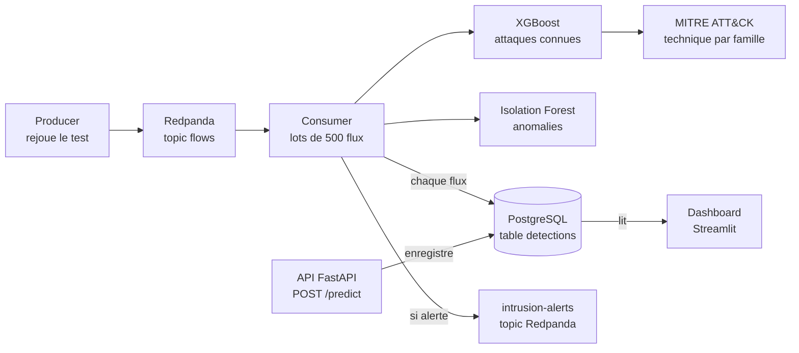
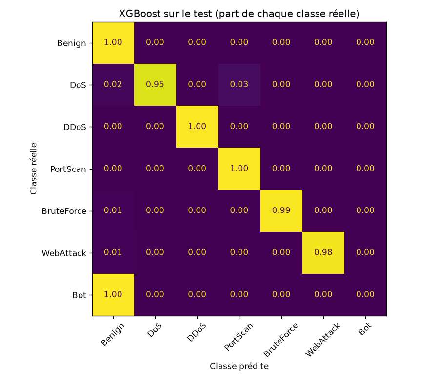

# Détection d'intrusions réseau en temps réel

[](https://github.com/rnnttou/intrusion-detection-pipeline/actions/workflows/ci.yml)

Pipeline complet de détection d'intrusions, sur le modèle d'un IDS de SOC : chaque flux réseau est
noté par deux détecteurs, les alertes sont publiées avec leur technique MITRE ATT&CK, tout est
enregistré dans PostgreSQL et suivi dans un dashboard.

- **XGBoost** reconnaît six familles d'attaques connues (DoS, DDoS, scan de ports, force brute, attaques web, botnet).
- **Isolation Forest**, entraîné sur du trafic normal uniquement, signale ce qui ne ressemble à rien de connu.
- Chaque alerte porte une **technique MITRE ATT&CK** (par exemple T1046 pour un scan de ports).

## Architecture



Un flux déclenche une alerte de priorité **haute** si XGBoost y voit une attaque connue, sinon une
alerte de priorité **basse** si l'Isolation Forest le trouve anormal (classe « Inconnu », sans
technique : à qualifier par l'analyste).

## Données

[CIC-IDS2017](https://www.unb.ca/cic/datasets/ids-2017.html) (Canadian Institute for Cybersecurity) :
cinq jours de trafic d'un réseau d'entreprise simulé, avec des attaques réelles rejouées. Chaque
ligne est un flux décrit par 78 mesures (durée, paquets, octets, drapeaux TCP, temps entre paquets).

Après nettoyage (valeurs infinies, doublons stricts) : **2 572 640 flux**, dont 16,5 % d'attaques.

| Famille | Étiquettes d'origine | Flux | Technique MITRE ATT&CK | Tactique |
|---|---|---|---|---|
| Benign | BENIGN | 2 146 899 | | |
| DoS | Hulk, GoldenEye, slowloris, Slowhttptest | 193 745 | T1499 Endpoint Denial of Service | Impact |
| DDoS | DDoS (LOIC) | 128 014 | T1498 Network Denial of Service | Impact |
| PortScan | PortScan | 90 694 | T1046 Network Service Discovery | Discovery |
| BruteForce | FTP-Patator, SSH-Patator | 9 150 | T1110 Brute Force | Credential Access |
| WebAttack | Brute Force, XSS, Sql Injection | 2 143 | T1190 Exploit Public-Facing Application | Initial Access |
| Bot | Bot (Ares) | 1 948 | T1071 Application Layer Protocol | Command and Control |
| Jamais vues | Infiltration (36), Heartbleed (11) | 47 | | |

Trois choix qui comptent pour lire les résultats :

1. **Split chronologique, pas aléatoire.** Dans chaque fichier, pour chaque étiquette, les 60 %
   premiers flux servent à l'entraînement, les 20 % suivants à la validation, les 20 % derniers au
   test. Un tirage au hasard placerait des flux voisins d'une même rafale d'attaque des deux côtés
   et donnerait des scores proches de 100 % qui ne veulent rien dire.
2. **Le port de destination n'est pas donné au modèle.** Il apprendrait « port 8080 = botnet » au
   lieu du comportement du flux. Le port reste affiché dans l'alerte.
3. **Infiltration et Heartbleed ne sont jamais montrées à l'entraînement** (47 flux, trop peu pour
   apprendre). Elles servent d'attaques réellement inconnues pour tester la détection d'anomalies.

## Résultats

Seuils fixés sur la validation, jamais sur le test : XGBoost pour au plus 1 fausse alerte sur 1 000
flux normaux, Isolation Forest pour au plus 1 sur 100.

### Attaques connues (XGBoost, test de 514 528 flux)

| Famille | Flux de test | Précision | Rappel |
|---|---|---|---|
| DoS | 38 751 | 99,1 % | 94,8 % |
| DDoS | 25 603 | 99,9 % | 99,8 % |
| PortScan | 18 139 | 93,4 % | 99,6 % |
| BruteForce | 1 831 | 99,3 % | 98,9 % |
| WebAttack | 430 | 88,7 % | 98,4 % |
| **Bot** | 390 | **0 %** | **0 %** |

| Mesure | Valeur |
|---|---|
| Attaques signalées (toutes familles) | 98,75 % |
| Fausses alertes XGBoost | 116 pour 100 000 flux normaux |
| Macro-F1 (7 classes) | 0,836 |

**Le botnet est entièrement raté sur le test**, alors que le modèle en reconnaît 74 % sur la
validation. Ce n'est pas un bug : les 390 derniers flux du botnet sont tous identiques (3 paquets
sans données vers le port 8080, environ 1 seconde), une balise qui retente de joindre son serveur
de commande. Ce comportement n'apparaît pas dans les 60 % d'entraînement. Un split aléatoire
l'aurait caché et aurait affiché près de 100 %. C'est le cas réel d'un attaquant qui change de
comportement : le modèle supervisé ne le suit pas.



### Attaques inconnues

Première mesure, sur les deux attaques jamais montrées à l'entraînement :

| Attaque | Flux | Signalés par XGBoost | Signalés par Isolation Forest |
|---|---|---|---|
| Heartbleed | 11 | 0 | 11 |
| Infiltration | 36 | 0 | 18 |

Deuxième mesure, pour avoir plus de 47 flux : on cache une famille entière à l'entraînement de
XGBoost, puis on regarde si elle est signalée sur le test ([src/zero_day.py](src/zero_day.py)).

| Famille cachée | Flux de test | Signalés par XGBoost | Signalés par Isolation Forest |
|---|---|---|---|
| DoS | 38 751 | 6,4 % | 57,2 % |
| DDoS | 25 603 | 0,0 % | 11,8 % |
| PortScan | 18 139 | 0,2 % | 0,0 % |
| BruteForce | 1 831 | 0,1 % | 0,0 % |
| WebAttack | 430 | 75,6 % | 0,5 % |
| Bot | 390 | 0,0 % | 0,0 % |

Ce que ces chiffres disent :

- **XGBoost est presque aveugle à une famille qu'il n'a jamais vue** (sauf les attaques web, qui
  ressemblent à d'autres classes). Un classifieur supervisé ne remplace pas la détection d'anomalies.
- **L'Isolation Forest attrape ce qui est massif ou très inhabituel** (DoS, Heartbleed, la moitié des
  infiltrations), au prix de 659 fausses alertes pour 100 000 flux normaux.
- **Il ne voit pas les attaques discrètes** : un scan de ports ou une tentative de mot de passe, pris
  flux par flux, ressemble à une connexion normale très courte. Les détecter sans étiquette
  demanderait de regarder plusieurs flux à la fois (nombre de ports contactés par une même source en
  une minute), ce que ce jeu de données ne permet pas : il ne contient pas les adresses IP.

Sur l'ensemble du test, l'Isolation Forest seul signale 29,6 % des attaques (AUC 0,82).

### Performance

| Mesure | Valeur |
|---|---|
| Latence, un flux à la fois (API) | p50 18 ms, p95 22 ms |
| Scoring par lots de 500 | 14 100 flux/s |
| Bout en bout (Redpanda → 2 modèles → Postgres) | 7 150 flux/s |

AMD Ryzen 7 7735HS, Windows 11. Bout en bout : consumer dans Docker, 50 000 flux en 7,0 s.
La latence unitaire vient surtout de l'Isolation Forest (200 arbres parcourus pour une seule ligne).

## Lancer le projet

Prérequis : Docker et Python 3.11.

```bash
# 1. Données : les 8 fichiers CSV « MachineLearningCVE » de CIC-IDS2017 dans data/
#    (formulaire sur https://www.unb.ca/cic/datasets/ids-2017.html, ou miroir Hugging Face c01dsnap/CIC-IDS2017)
pip install -r requirements.txt
python -m src.prepare          # nettoyage + split -> data/flows.parquet

# 2. Tout démarrer (Postgres, Redpanda, API, consumer, dashboard)
docker compose up --build -d
docker compose exec redpanda rpk topic create flows intrusion-alerts

# 3. Rejouer des flux du test (16,5 % d'attaques, ou --attack-share 0.02 pour un trafic plus réaliste)
docker compose run --rm producer --rate 500 --limit 20000
```

- Dashboard : http://localhost:8502
- API : http://localhost:8001/docs
- Alertes : `docker compose exec redpanda rpk topic consume intrusion-alerts -n 5`

Exemple de réponse de `POST /predict` :

```json
{
  "predicted_class": "PortScan",
  "attack_probability": 0.9999,
  "anomaly_score": 0.33,
  "is_alert": true,
  "detector": "xgboost",
  "severity": "haute",
  "mitre": {"id": "T1046", "name": "Network Service Discovery", "tactic": "Discovery"}
}
```

Réentraîner et réévaluer :

```bash
python -m src.train       # XGBoost + Isolation Forest -> models/ (environ 5 minutes)
python -m src.evaluate    # seuils, métriques, matrice de confusion -> reports/
python -m src.zero_day    # expérience des familles cachées (6 entraînements)
python -m src.benchmark   # latence et débit
python -m pytest          # tests
```

## Limites

- **Trafic simulé de 2017.** Les scores sur CIC-IDS2017 ne se transposent pas à un vrai réseau ; le jeu a aussi des erreurs d'étiquetage connues (notamment sur Bot et les attaques web).
- **Un flux à la fois, sans adresses IP.** Impossible de corréler les flux d'une même source, ce qui limite la détection des scans et de la force brute sans étiquettes.
- **Correspondance MITRE faite à la main, par famille.** Elle oriente l'analyste mais ne distingue pas les sous-techniques (un XSS et une injection SQL partagent T1190).
- **Rejeu mélangé.** Le producer mélange les flux du test pour montrer toutes les familles ; un vrai trafic arrive par rafales.
- **Pas de suivi de dérive ni de réentraînement** dans ce projet (voir [fraud-detection-pipeline](https://github.com/rnnttou/fraud-detection-pipeline), où ils sont en place).
- **Isolation Forest comme seul détecteur d'anomalies.** Un autoencodeur serait la comparaison suivante à faire.
